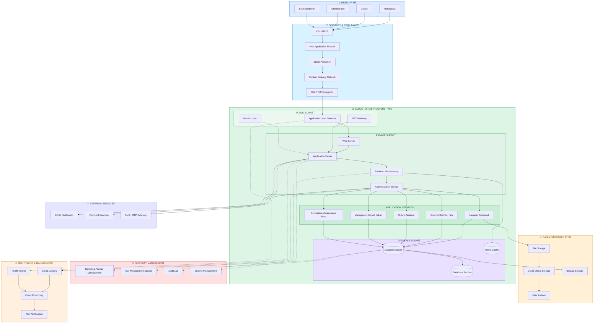
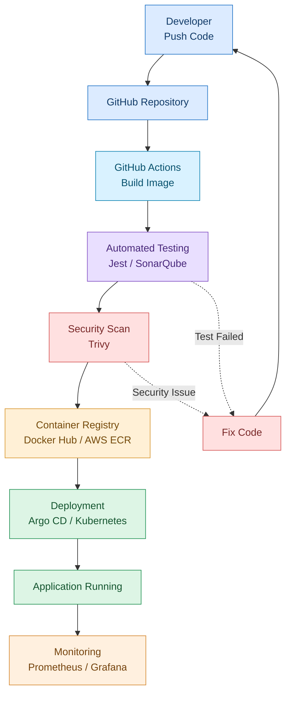
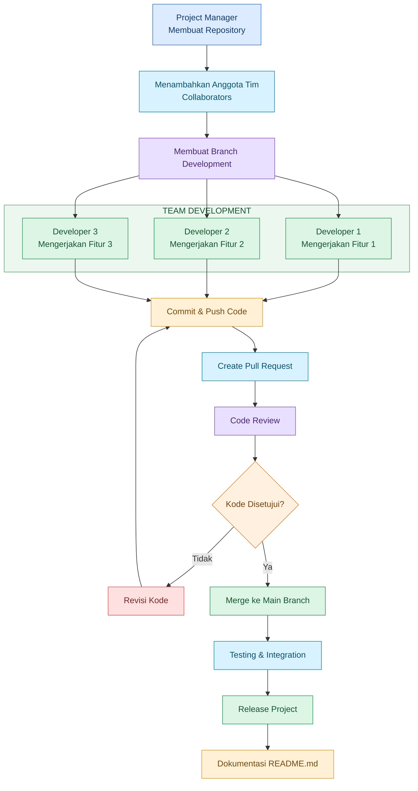

# DIAGRAM ARSITEKTUR CLOUD SISTEM INFORMASI KAMPUS

## Deskripsi Proyek

Proyek ini menggambarkan rancangan infrastruktur cloud untuk Sistem Informasi Layanan Kampus. Sistem digunakan oleh mahasiswa, dosen, administrator, dan staf akademik.

Proyek ini terdiri dari tiga diagram utama:

1. Arsitektur Cloud Sistem Informasi Kampus.
2. Pipeline CI/CD (Continuous Integration / Continuous Deployment).
3. Alur Kerja Kolaborasi Tim Menggunakan GitHub.

---

# 1. DIAGRAM ARSITEKTUR CLOUD SISTEM INFORMASI KAMPUS

Diagram ini menggambarkan infrastruktur cloud yang mencakup pengguna, keamanan jaringan, server aplikasi, database, penyimpanan data, monitoring, dan layanan eksternal.

### Penjelasan

- User Layer: Pengguna sistem kampus.
- Security & Edge Layer: Perlindungan dan pengamanan akses.
- Cloud Infrastructure: Tempat server dan aplikasi berjalan.
- Data & Storage: Penyimpanan database dan file.
- Security Management: Pengelolaan identitas dan keamanan.
- Monitoring: Pemantauan kondisi sistem.
- External Services: Integrasi email, pembayaran, dan OTP.

---

# 2. DIAGRAM PIPELINE CI/CD

Pipeline CI/CD adalah proses otomatis untuk mengintegrasikan, menguji, dan melakukan deployment aplikasi.

### Penjelasan

1. Developer melakukan Push Code ke GitHub.
2. GitHub menyimpan kode dalam repository.
3. GitHub Actions menjalankan proses Build.
4. Automated Testing memeriksa kualitas aplikasi.
5. Security Scan memeriksa keamanan kode.
6. Container Registry menyimpan Docker Image.
7. Argo CD dan Kubernetes melakukan deployment.
8. Aplikasi berjalan dan dapat digunakan.
9. Prometheus dan Grafana melakukan monitoring.

Jika pengujian atau pemindaian keamanan gagal, developer memperbaiki kode dan mengulang proses.

---

# 3. DIAGRAM ALUR KERJA KOLABORASI TIM GITHUB

Diagram ini menggambarkan proses kerja sama beberapa anggota tim dalam mengembangkan proyek menggunakan GitHub.

### Penjelasan

1. Project Manager membuat repository GitHub.
2. Anggota tim ditambahkan sebagai collaborator.
3. Tim membuat branch untuk pengembangan.
4. Setiap developer mengerjakan fitur masing-masing.
5. Developer melakukan Commit dan Push Code.
6. Developer membuat Pull Request.
7. Anggota tim melakukan Code Review.
8. Jika ada kesalahan, kode diperbaiki.
9. Jika disetujui, kode di-merge ke Main Branch.
10. Tim melakukan testing, integrasi, dan release.
11. Dokumentasi proyek dilengkapi dalam README.md.

---

# 4. KESIMPULAN

Berdasarkan ketiga diagram tersebut, dapat disimpulkan bahwa sistem informasi layanan kampus membutuhkan infrastruktur cloud yang aman, terintegrasi, dan dapat dipantau.

Pipeline CI/CD membantu proses pengembangan dan deployment aplikasi menjadi lebih otomatis dan efisien.

Sementara itu, kolaborasi tim menggunakan GitHub membantu setiap anggota bekerja secara terstruktur melalui branch, commit, pull request, code review, dan merge.

Ketiga diagram tersebut saling mendukung dalam membangun dan mengelola Sistem Informasi Layanan Kampus berbasis Cloud Computing.
